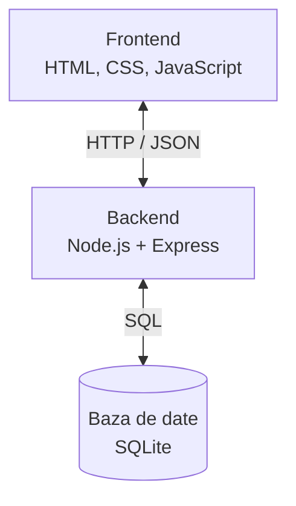

# Arhitectura aplicației TogetherPlan

## 1. Descriere generală

TogetherPlan va utiliza o arhitectură de tip client-server, organizată în trei componente principale: frontend, backend și bază de date.

Această structură permite separarea interfeței utilizatorului de logica aplicației și de stocarea datelor.

## 2. Diagrama arhitecturii

## 3. Componentele aplicației

### 3.1 Frontend

Frontend-ul reprezintă partea vizibilă a aplicației, cu care interacționează utilizatorul.

Tehnologii propuse:
- HTML pentru structura paginilor.
- CSS pentru aspectul vizual.
- JavaScript pentru interactivitate.

Ecranele principale sunt:
- Autentificare și înregistrare.
- Pagina principală.
- Grupuri.
- Sarcini.
- Liste de cumpărături.
- Calendar.
- Cheltuieli.

### 3.2 Backend

Backend-ul va fi realizat folosind Node.js și Express.

Responsabilități:
- Preluarea cererilor de la frontend.
- Înregistrarea și autentificarea utilizatorilor.
- Verificarea drepturilor de acces.
- Gestionarea grupurilor și sarcinilor.
- Gestionarea listelor colaborative.
- Validarea datelor.
- Comunicarea cu baza de date.

Backend-ul va expune un API REST, prin care frontend-ul va trimite cereri HTTP și va primi răspunsuri JSON.

### 3.3 Baza de date

Pentru stocarea datelor propunem SQLite.

Baza de date va păstra informații despre:
- Utilizatori.
- Grupuri și membrii acestora.
- Sarcini.
- Liste de cumpărături și produse.
- Cheltuieli comune.

SQLite a fost ales deoarece este simplu de configurat și potrivit pentru un prototip destinat grupurilor mici.

## 4. Comunicarea dintre componente

1. Utilizatorul efectuează o acțiune în interfața web.
2. Frontend-ul trimite o cerere HTTP către backend.
3. Backend-ul verifică autentificarea, permisiunile și datele primite.
4. Backend-ul execută operația necesară asupra bazei de date.
5. Baza de date returnează rezultatul.
6. Backend-ul trimite un răspuns JSON către frontend.
7. Frontend-ul actualizează informațiile afișate utilizatorului.

## 5. Exemplu de comunicare – Crearea unei sarcini

1. Utilizatorul completează formularul pentru o sarcină.
2. Frontend-ul trimite o cerere POST către /api/tasks.
3. Backend-ul verifică datele și apartenența utilizatorului la grup.
4. Sarcina este salvată în baza de date.
5. Backend-ul returnează confirmarea și datele sarcinii.
6. Frontend-ul afișează noua sarcină.

## 6. Securitate

Aplicația va utiliza următoarele măsuri:
- Parolele vor fi stocate sub formă de hash securizat.
- Operațiile asupra datelor private vor necesita autentificare.
- Backend-ul va verifica apartenența utilizatorului la grup.
- Datele introduse vor fi validate.
- Interogările SQL vor utiliza parametri pentru prevenirea injecțiilor SQL.
- Comunicarea va utiliza HTTPS în cazul publicării online.

## 7. Servicii externe

În prima versiune nu sunt necesare servicii externe.

Calendarul va afișa datele sarcinilor din baza de date proprie, fără integrare cu Google Calendar sau alte servicii.

## 8. Limitări și dezvoltări viitoare

Arhitectura este proiectată pentru un prototip destinat grupurilor mici.

Funcționalitățile secundare, precum calendarul și cheltuielile, pot fi implementate după finalizarea funcționalităților obligatorii.

În viitor, aplicația ar putea include notificări, integrarea cu servicii externe și o bază de date adaptată unui număr mai mare de utilizatori.
